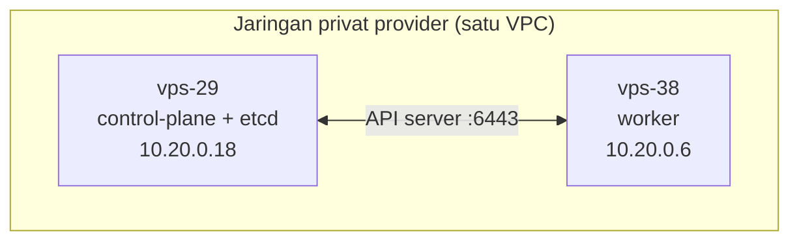

# Arsitektur Klaster k3s

Status: **berjalan, 2 node** — terakhir diverifikasi 26 November 2026 ~01:13.

## Gambaran

## Node

| Node | Peran | OS | Kernel | Container runtime | k3s | Internal-IP | PodCIDR |
| --- | --- | --- | --- | --- | --- | --- | --- |
| `vps-29` | control-plane | Ubuntu 26.04.1 LTS | 7.0.0-42-generic (amd64) | containerd 2.3.4-k3s1.36 | v1.36.5+k3s1 | 10.20.0.18 | 10.42.0.0/24 |
| `vps-38` | worker | Ubuntu 26.04.1 LTS | 7.0.0-34-generic (amd64) | containerd 2.3.4-k3s1.36 | v1.36.5+k3s1 | 10.20.0.6 | 10.42.1.0/24 |

- `vps-29` berumur 24 hari saat `vps-38` bergabung; `vps-38` bergabung 26 November 2026 ~01:13 dan langsung berstatus **Ready**.
- Versi k3s agent **harus sama persis** dengan server (`v1.36.5+k3s1`), jangan `latest`.
- `vps-38` membawa label `node-role.kubernetes.io/worker=true` dan `workload=render` — Job render dijadwalkan ke node ini lewat `nodeSelector: { workload: render }`.

## Jaringan

- Kedua node satu VPC, saling menjangkau lewat IP privat (ping `10.20.0.18` dari `vps-38`: 0% loss, ~0,5 ms).
- API server k3s dijangkau worker lewat `https://10.20.0.18:6443` (dari sisi server sendiri: `https://127.0.0.1:6443`).
- Flannel (vxlan) untuk jaringan pod antar-node; `vps-29` memakai podCIDR `10.42.0.0/24`, `vps-38` mendapat `10.42.1.0/24` saat registrasi.
- Alamat join alternatif (Tailscale `100.123.155.8` atau publik `103.77.78.114`) hanya boleh dipakai setelah alamatnya dipastikan ada di SAN sertifikat server (cek dengan `openssl s_client`). Jangan pernah pakai `--insecure-skip-tls-verify` — yang benar adalah tambah `--tls-san <alamat>` di config server lalu restart k3s server.

## Namespace

| Namespace | Isi |
| --- | --- |
| `apps` | Kanban / Command Center, `hq-ws` (websocket realtime), office-3d |
| `core-infra` | PostgreSQL, Redis |
| `render` | Job render + PVC `render-work` 10Gi |
| `kube-system` | Komponen sistem k3s (CoreDNS, Traefik, dsb.) |

## Keputusan desain

1. **vps-29 tetap control-plane + etcd, VPS baru worker saja (agent-only).** Perintah install di mesin baru memakai `K3S_URL`, sehingga yang terpasang hanya agent — node baru tidak pernah menjadi control-plane atau etcd.
2. **Control-plane tunggal = single point of failure.** Kalau `vps-29` mati, seluruh klaster ikut mati; worker baru tidak mengubah itu. Untuk HA perlu 2 node control-plane lagi (etcd butuh quorum ganjil).
3. **Node-token hanya ada sebagai file di server** (`/var/lib/rancher/k3s/server/node-token`), tidak tersedia lewat API Kubernetes. Token diambil dengan `sudo cat` di server dan diisi langsung di mesin baru — tidak pernah ditempel di chat dan tidak pernah masuk repo.
4. **Akses sudo di vps-29 terbatas ke kubectl** (`/usr/local/bin/kubectl`). Perubahan config server (`/etc/rancher/k3s/config.yaml`) dan operasi node lain yang butuh root dikerjakan langsung oleh pemilik server.

## Riwayat

- 26 Nov 2026 ~01:13 — `vps-38` bergabung sebagai worker. Detail langkahnya: [docs/01-tambah-worker-node.md](docs/01-tambah-worker-node.md).
