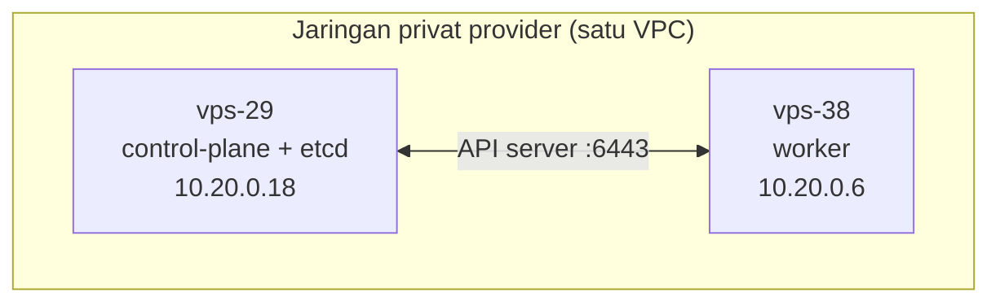

# Arsitektur Klaster k3s

Status: **berjalan, 2 node** — terakhir diverifikasi 26 November 2026 ~01:20 (assessment GC + optimasi).

## Gambaran

## Node

| Node | Peran | OS | Kernel | Container runtime | k3s | Internal-IP | PodCIDR |
| --- | --- | --- | --- | --- | --- | --- | --- |
| `vps-29` | control-plane | Ubuntu 26.04.1 LTS | 7.0.0-42-generic (amd64) | containerd 2.3.4-k3s1.36 | v1.36.5+k3s1 | 10.20.0.18 | 10.42.0.0/24 |
| `vps-38` | worker | Ubuntu 26.04.1 LTS | 7.0.0-34-generic (amd64) | containerd 2.3.4-k3s1.36 | v1.36.5+k3s1 | 10.20.0.6 | 10.42.1.0/24 |

- `vps-29` berumur 24 hari saat `vps-38` bergabung; `vps-38` bergabung 26 November 2026 ~01:13 dan langsung berstatus **Ready**.
- Versi k3s agent **harus sama persis** dengan server (`v1.36.5+k3s1`), jangan `latest`.
- `vps-38` membawa label `node-role.kubernetes.io/worker=true` dan `workload=render` — Job render dijadwalkan ke node ini lewat `nodeSelector: { workload: render }`.

## Jaringan

- Kedua node satu VPC, saling menjangkau lewat IP privat (ping `10.20.0.18` dari `vps-38`: 0% loss, ~0,5 ms).
- API server k3s dijangkau worker lewat `https://10.20.0.18:6443` (dari sisi server sendiri: `https://127.0.0.1:6443`).
- Flannel (vxlan) untuk jaringan pod antar-node; `vps-29` memakai podCIDR `10.42.0.0/24`, `vps-38` mendapat `10.42.1.0/24` saat registrasi.
- Alamat join alternatif (Tailscale `100.123.155.8` atau publik `103.77.78.114`) hanya boleh dipakai setelah alamatnya dipastikan ada di SAN sertifikat server (cek dengan `openssl s_client`). Jangan pernah pakai `--insecure-skip-tls-verify` — yang benar adalah tambah `--tls-san <alamat>` di config server lalu restart k3s server.

## Namespace

| Namespace | Isi |
| --- | --- |
| `apps` | Kanban / Command Center, `hq-ws` (websocket realtime), office-3d |
| `core-infra` | PostgreSQL, Redis |
| `render` | Job render + PVC `render-work` 10Gi |
| `kube-system` | Komponen sistem k3s (CoreDNS, Traefik, dsb.) |

## Kapasitas & garbage collection

Angka dari assessment 26 November 2026 ~01:16–01:20 (detail lengkap:
[docs/02-garbage-collection-optimasi.md](docs/02-garbage-collection-optimasi.md)):

| Ukuran | vps-29 | vps-38 |
| --- | --- | --- |
| Disk total / terpakai / bebas | 123,75 GB / 96,19 GB (78%) / 27,54 GB | 123,75 GB / 3,47 GB (3%) / 120,26 GB |
| Image store (imagefs) | **45,09 GB** (36% dari disk) | 0,09 GB |
| Memori terpakai | 5.986–6.101 Mi (**75–76%**), bebas ~2,06 GB | 303 Mi (3%), bebas ~8,0 GB |
| CPU | 20–39% | 0% |

- **Satu-satunya penumpukan nyata: image store 45 GB di vps-29** (VoiceStudio 17 GB +
  Playwright + image Rancher/fleet/cert-manager/traefik + image lama). kubelet image GC
  default (high 85% / low 80%) tidak akan pernah aktif pada imagefs 36% — GC baru jalan
  bila imagefs melewati 85%.
- **Memori vps-29 75–76%** — penyebabnya pod `rancher` **2.317 Mi tanpa resource limit**
  (spec resources `{}`); seluruh stack Rancher ≈ **2,7 GB**. Tidak ada MemoryPressure,
  tapi ruang gerak sempit: satu Job render (peak 1,6 GB) + VoiceStudio (peak 3,4 GB)
  tidak muat bersamaan.
- **Flag kubelet GC yang direncanakan (MENUNGGU diterapkan):**
  `image-gc-high-threshold=70`, `image-gc-low-threshold=60`,
  `minimum-image-ttl-duration=2h`, `container-log-max-size=10Mi`,
  `container-log-max-files=5` — di `/etc/rancher/k3s/config.yaml` kedua node, lalu restart
  k3s / k3s-agent. Prune image satu kali (`crictl rmi --prune`, perkiraan reclaim 10–30 GB)
  juga menunggu — hati-hati: image VoiceStudio 17 GB ikut terhapus bila di-prune.
- **Pembersihan level-API sudah selesai:** Job completed 7 → 3, pod Completed 7 → 3
  (CronJob `fleet-local/rke2-machineconfig-cleanup-cronjob` historyLimit 3 → 1, template
  `remotion-smoke-job.yaml` ditambah TTL 86400). Membersihkan objek API/etcd **tidak**
  membebaskan RAM/disk.
- **Pelajaran: JANGAN hapus Job `helm-install-*`** — k3s helm-controller membuatnya ulang
  sendiri dalam ~35 detik.

## Keputusan desain

1. **vps-29 tetap control-plane + etcd, VPS baru worker saja (agent-only).** Perintah install di mesin baru memakai `K3S_URL`, sehingga yang terpasang hanya agent — node baru tidak pernah menjadi control-plane atau etcd.
2. **Control-plane tunggal = single point of failure.** Kalau `vps-29` mati, seluruh klaster ikut mati; worker baru tidak mengubah itu. Untuk HA perlu 2 node control-plane lagi (etcd butuh quorum ganjil).
3. **Node-token hanya ada sebagai file di server** (`/var/lib/rancher/k3s/server/node-token`), tidak tersedia lewat API Kubernetes. Token diambil dengan `sudo cat` di server dan diisi langsung di mesin baru — tidak pernah ditempel di chat dan tidak pernah masuk repo.
4. **Akses sudo di vps-29 terbatas ke kubectl** (`/usr/local/bin/kubectl`). Perubahan config server (`/etc/rancher/k3s/config.yaml`) dan operasi node lain yang butuh root dikerjakan langsung oleh pemilik server.
5. **Garbage collection: threshold saja tidak cukup.** Image GC kubelet baru aktif saat
   imagefs melewati ambang — jadi penumpukan yang sudah ada dibersihkan manual satu kali
   (prune), baru threshold 70/60 menjaga supaya tidak menumpuk lagi. CronJob GC
   privileged hanya cadangan; rekomendasi pakai prune + flag kubelet saja.

## Riwayat

- 26 Nov 2026 ~01:13 — `vps-38` bergabung sebagai worker. Detail langkahnya: [docs/01-tambah-worker-node.md](docs/01-tambah-worker-node.md).
- 26 Nov 2026 ~01:20 — assessment garbage collection + optimasi; pembersihan level-API selesai, perubahan level-node menunggu tangan pemilik server. Detailnya: [docs/02-garbage-collection-optimasi.md](docs/02-garbage-collection-optimasi.md).
